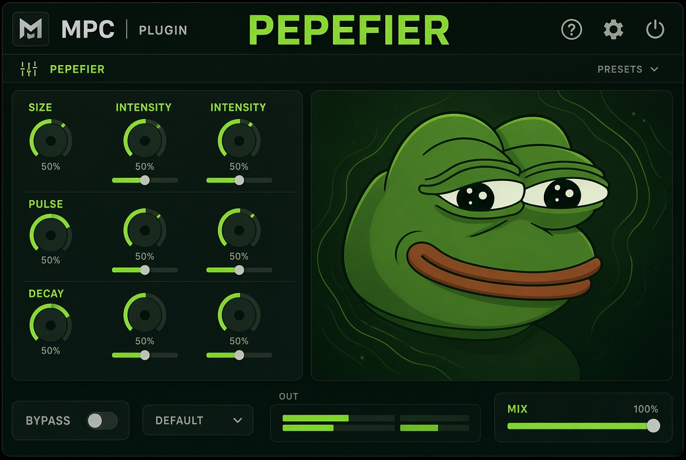
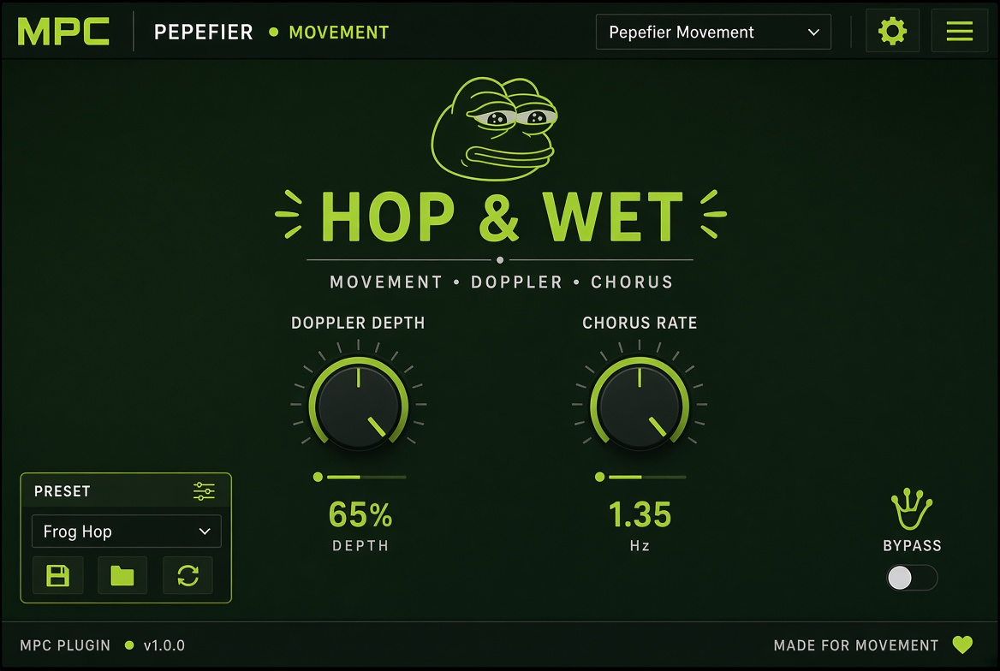
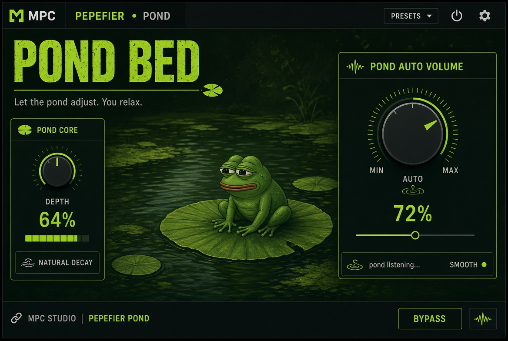

# Pepefier User Manual

**Version 1.0**  
**Pepe Labs**

Pepefier is a procedural frog sound instrument for Akai MPC. It turns MIDI notes into croaks, ribbits, peeps and pond ambience, with a Pepe the Frog themed touchscreen interface.

---

## 1. Overview

Pepefier models real frog vocalisation:

- A noise/pulse excitation (the “glottal” source)
- One or two high-Q formant filters (the vocal sac resonance)
- Mode-specific envelopes and pulsing
- Spatial and ambience effects (Doppler, chorus, depth, pond)

It is an instrument. Play notes on the MPC pads or from an external keyboard.

---

## 2. Touchscreen Pages

The plugin has three pages, selected with the function keys under the screen.

### Croak page

Main sound controls and the animated Pepe face.

| Control | What it does |
|---------|--------------|
| **Mode** | Selects the frog type (Bullfrog, Ribbit, Peeper, Trill, Honk, Pepe Special) |
| **Size** | Scales all formant frequencies. Lower = bigger frog. |
| **Intensity** | Strength of the excitation. Higher = louder, more aggressive call. |
| **Pulse Rate** | How fast the croak is pulsed (Hz). |
| **Decay** | Length of the call. |
| **Sweep** | Amount of formant movement during the call. |

The Pepe face on the right animates continuously.

### Move page

Spatial and thickening effects.

| Control | What it does |
|---------|--------------|
| **Doppler** | Simulates movement across the pond (pitch + level change). |
| **Depth** | Low-pass filtering for distance. |
| **Chorus** | Stereo chorus mix. |
| **Chor Rate** | Chorus LFO speed. |
| **Chor Depth** | Chorus modulation amount. |

### Pond page

Ambience and generative controls. The background is a pond scene.

| Control | What it does |
|---------|--------------|
| **Pond** | Level of the water/pond bed. |
| **Auto** | Generative croak density. Raise it and the pond starts croaking by itself. |
| **Volume** | Master output level. |

---

## 3. Modes in Detail

### Bullfrog
Deep, slow, highly resonant. Best for low notes and atmospheric beds.  
Try: Size 1.1, Pulse ~9 Hz, Decay 360 ms, Sweep low.

### Ribbit
True diphasic call — short first part, then a brighter, faster second syllable.  
The classic “ribbit”.

### Peeper
Very high, short, rising peep. Almost a single note.  
Great for sparse high accents.

### Trill
Even musical pulses. Gray-treefrog style.

### Honk
Nasal, longer notes. Green-treefrog character.

### Pepe Special
Exaggerated sweeps, stronger saturation, more chaotic.  
The meme mode.

---

## 4. Factory Presets

| Preset | Description |
|--------|-------------|
| **Init** | Neutral starting point |
| **Bullfrog** | Deep and resonant |
| **Ribbit** | Classic diphasic |
| **Peeper** | High and short |
| **Trill** | Musical pulses |
| **Honk** | Nasal longer notes |
| **Pepe Special** | Chaotic and saturated |
| **Night Pond** | Ambient with Auto density and heavy pond/depth |
| **Chorus Ribbit** | Ribbit with stronger chorus |

Select presets from the MPC’s plugin preset list.

---

## 5. Tips

- Play lower notes for bigger frogs; higher notes for smaller ones. Size also scales this.
- Raise **Auto** on the Pond page and leave it running for a living pond bed.
- Use **Doppler** and **Depth** together to place frogs in space.
- **Pepe Special** + high Sweep + high Intensity is the most cartoonish setting.
- The pond bed and chorus are always available; mix them to taste.

---

## 6. Installation

1. Download the release zip.
2. Copy the folder `Pepe Labs - VST - Pepefier` into the MPC `VST2 Plugins` directory.
3. Enable External Plugin Support (Preferences → Enhancements).
4. Rescan.

Requires MPC OS 3.10.1 or later.

---

## 7. Technical Notes

- 8-voice polyphonic.
- Procedural (no samples required).
- Custom touch UI with animated Pepe face and lime film-strip knobs.
- Built with the official MPC Plugin SDK.

---

*Pepefier — Pepe Labs*
